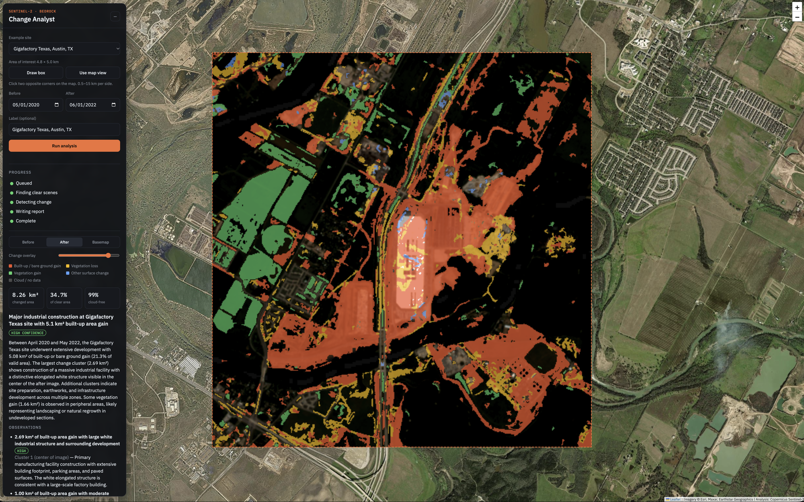
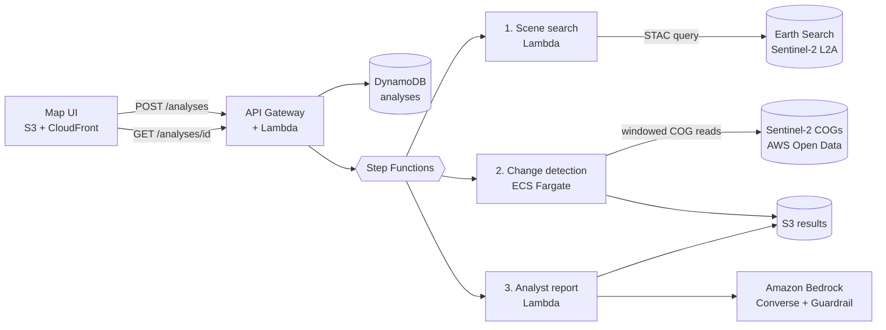

# Geospatial Change Detection + Gen AI on AWS

AI copilot that detects and explains changes at sites of interest using Sentinel-2
satellite imagery. Draw a box on a map, pick two dates, and the pipeline finds
clear scenes, measures what changed, and has a multimodal model on Amazon Bedrock
write an analyst-style report. Everything deploys and tears down with Python CDK.

> Built as a portfolio demo of AWS architecture for ISR-style workflows using
> **only open, civilian data**. No controlled or sensitive information is used.



*Example run: Gigafactory Texas, Austin, May 2020 → June 2022. Orange-red marks
new built-up or bare ground, amber vegetation loss and green vegetation gain. The
detector measured 8.26 km² of change on a 99% cloud-free scene pair, and the
Bedrock report identifies the new factory building as the largest change cluster.*

## How it works



1. **Scene search (Lambda).** Queries the Earth Search STAC API for Sentinel-2 L2A
   scenes that fully cover the area, then picks the clearest scene near each date,
   preferring the same MGRS tile for both so the viewing geometry matches.
2. **Change detection (Fargate).** Reads only the pixels inside the area from the
   Cloud-Optimized GeoTIFFs (HTTP range requests), resamples both dates onto a
   shared ~10 m grid, masks clouds with the Scene Classification Layer, and
   classifies change from NDVI, NDBI and brightness differences:

   | Class | Signal | Typical cause |
   |---|---|---|
   | Built-up / bare ground gain | NDBI up, NDVI down | construction, grading, new paving |
   | Vegetation loss | NDVI down sharply | clearing, harvest, fire |
   | Vegetation gain | NDVI up sharply | regrowth, landscaping, season |
   | Other surface change | brightness shift | new roofing, parking, water level |

   Speckle smaller than 800 m² is removed, then the largest change clusters are
   located and summarised. Outputs: before/after true-colour PNGs, a change
   overlay, and `stats.json`.
3. **Analyst report (Lambda + Bedrock).** Sends the three images and the
   statistics to a multimodal model through the Converse API. The prompt keeps the
   model to what is observable at 10 m and to the measured numbers, and asks for
   likely explanations, confidence and possible false positives as JSON.
   A **Bedrock Guardrail** filters harmful content and denies targeting or
   strike-planning requests.

## Design choices

- **Cheap when idle.** No NAT gateway (Fargate runs in public subnets, outbound
  only, with a free S3 gateway endpoint). Lambdas, Step Functions, DynamoDB
  on-demand and S3 cost close to nothing between demos.
- **Clean teardown.** Buckets use `auto_delete_objects`, tables and log groups
  use `RemovalPolicy.DESTROY`, and results expire after 30 days.
- **Explainable first.** Spectral-index change detection is fast and easy to
  defend. A foundation-model detector is on the roadmap, not a prerequisite.
- **Responsible AI.** Guardrail, low temperature, structured output, explicit
  limitations in every report, and a hard throttle on the public API.
- **GovCloud-ready pattern.** Bedrock, Step Functions, Fargate and Lambda are all
  available in AWS GovCloud (US); swapping the region and the open data source is
  the main change.

## Stacks

| Stack | Contents | Deploy when |
|---|---|---|
| `GeoChange-Storage` | Results bucket, analyses table | Always |
| `GeoChange-Pipeline` | VPC, Fargate task, Lambdas, Step Functions, guardrail, API | Always |
| `GeoChange-Frontend` | Map UI on S3 + CloudFront | Always |
| `GeoChange-CostGuard` | AWS Budgets email alert | Only with `-c budgetEmail=...` |

## Deploy

Prerequisites: AWS CLI credentials, Python 3.12+, Node.js 18+ (for the CDK CLI),
and Docker running locally (CDK builds the change-detector image).

```bash
python -m venv .venv && source .venv/bin/activate
pip install -r requirements-dev.txt
npm install -g aws-cdk

export CDK_DEFAULT_REGION=us-west-2   # Sentinel-2 COGs live here
cdk bootstrap
cdk deploy --all
# optional cost alert:
cdk deploy --all -c budgetEmail=you@example.com -c budgetLimitUsd=20
```

The `GeoChange-Frontend` output `SiteUrl` is the app. Choose an example site, or
draw a box and pick two dates.

**Bedrock model.** The report model is set by `bedrockModelId` in `cdk.json`
(a cross-region inference profile ID). Change it with
`-c bedrockModelId=<id>`. Some models need a one-time use-case form or
Marketplace subscription on first use; check the Bedrock console's model catalog
if the report step fails with an access error.

## Tear down

```bash
cdk destroy --all
```

The CDK bootstrap stack and the container image in the bootstrap ECR repository
remain, as with any CDK project.

## Test

```bash
pytest                 # or: python -m unittest discover -s tests -t .
cdk synth              # also exercised by tests/test_stacks.py
```

Unit tests cover change classification, cloud masking, cluster statistics, the
Web Mercator grid, scene selection, API validation and report parsing. They run
without AWS credentials or network access.

## API

| Method | Path | Body / result |
|---|---|---|
| `POST` | `/analyses` | `{bbox: [minLon, minLat, maxLon, maxLat], before_date, after_date, label?}` → `{analysis_id}` |
| `GET` | `/analyses` | 25 most recent analyses |
| `GET` | `/analyses/{id}` | status, scenes, and when complete: report, stats, signed image URLs |

Areas must be 0.5–15 km per side and dates at least 14 days apart.

## Limitations

- **10 m resolution.** Shows facilities, earthworks and land cover; individual
  vehicles, aircraft or small structures are not resolvable.
- **Clouds and season.** Cloudy areas are masked out, and seasonal vegetation or
  sun-angle differences can look like change. Comparing the same season across
  years works best.
- **Water.** Tides and reservoir levels register as surface change.
- **Public, unauthenticated API.** Throttled to 2 req/s for the demo. Add Cognito
  before sharing widely.

## Roadmap

- `GeoChange-Model` stack: fine-tuned geospatial foundation model (for example
  NASA/IBM Prithvi) on a SageMaker endpoint, deployed only for demos.
- Sentinel-1 radar for cloud-independent change.
- Time-series mode (monthly change across a year) and alerting on new change.
- Cognito sign-in and per-user history.

## Data and credits

Contains modified Copernicus Sentinel data, accessed through the
[Sentinel-2 Cloud-Optimized GeoTIFFs](https://registry.opendata.aws/sentinel-2-l2a-cogs/)
on the Registry of Open Data on AWS and the Element 84 Earth Search STAC API.
Basemap imagery © Esri and its providers.

## License

MIT
